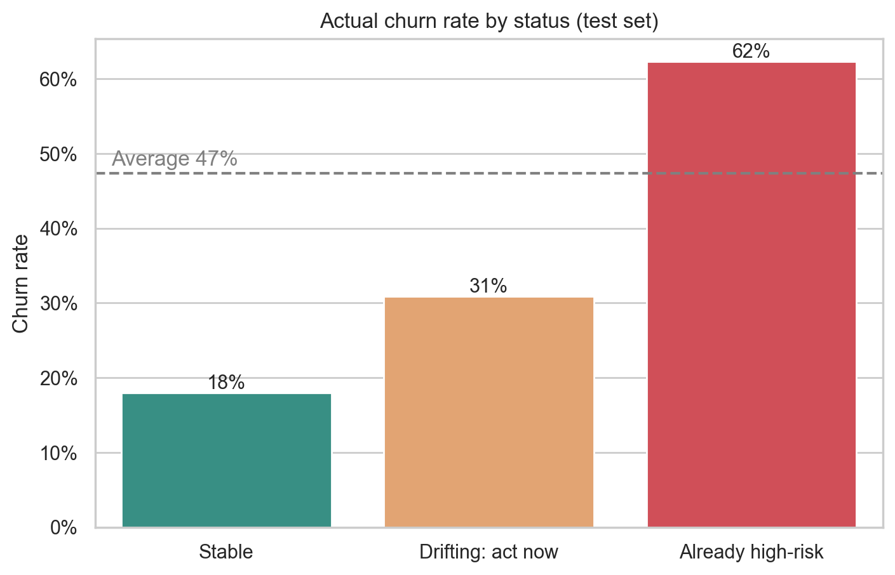
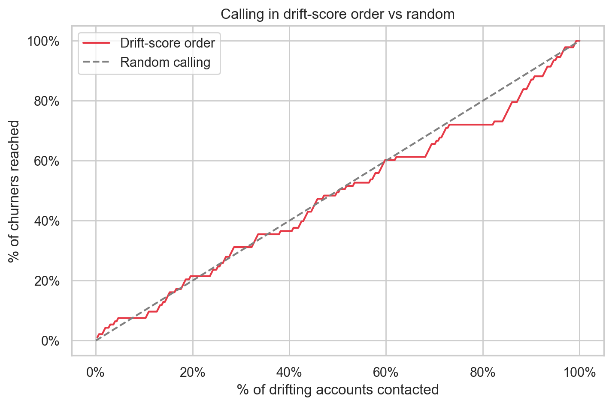

# Customer Churn Early Detection: K-Means Segmentation + KNN Drift Score

This project looks for customers who are **still active but behave like customers who leave**, and ranks them so account managers know whom to review first.

1. **K-Means** splits customers into groups based on behaviour and finds the group most likely to churn.
2. **KNN** scores every customer on how close their behaviour is to that high-risk group. This score is called the **drift score**.

The project does **not** test whether a retention action (such as a discount) works. The discount is the action the list is meant to support, not something measured here. See [Limitations](#limitations).

---

## Preview




---

## Table of Contents

- [Problem](#problem)
- [Data](#data)
- [Approach](#approach)
- [Results](#results)
- [What the Results Mean in Plain Language](#what-the-results-mean-in-plain-language)
- [Limitations](#limitations)
- [Possible Next Steps](#possible-next-steps)
- [Project Structure](#project-structure)
- [Installation and Usage](#installation-and-usage)
- [Configuration](#configuration)
- [Tech Stack](#tech-stack)

---

## Problem

Account managers can only contact a limited number of customers each week. A churn model that outputs a probability for every customer does not tell them where to start. This project tries to produce a short, ranked list of customers who **have not left and are not yet in the clearly high-risk group, but are moving toward it**.

## Data

A public customer churn dataset, supplied as two CSV files with the same columns.

| Dataset | Rows (after cleaning) | Churn rate | Used for |
|---|---|---|---|
| Training (`customer_churn_dataset-training-master.csv`) | **440,832** | 56.7% | Fit the scaler, K-Means and KNN |
| Testing (`customer_churn_dataset-testing-master.csv`) | **64,374** | 47.4% | Check the flags on customers the models never saw |

Cleaning: column names stripped, rows with missing values dropped, duplicate `CustomerID`s removed.

**Columns:** `CustomerID`, `Age`, `Gender`, `Tenure`, `Usage Frequency`, `Support Calls`, `Payment Delay`, `Subscription Type`, `Contract Length`, `Total Spend`, `Last Interaction`, `Churn`

Data files are not included in this repository. Place them in the `data/` folder.

## Approach

```
Behaviour features -> K-Means groups -> Find high-risk group -> KNN drift score -> Flag and rank drifting customers
```

**1. K-Means segmentation.** Customers are grouped on four standardised behaviour features: `Usage Frequency`, `Last Interaction` (days since last interaction), `Support Calls`, and `Payment Delay`. The `Churn` column is **not** used to build the groups. It is only used afterwards to see which group churns most, and that group is labelled **High-risk**. The number of groups (k) was chosen by silhouette score, which selected **k = 2**.

**2. KNN drift score.** A KNN model (25 neighbours) learns to recognise the high-risk group. For each customer it reports what share of their 25 most similar customers belong to the high-risk group. That share, from 0 to 1, is the drift score.

**3. Status flags.**

| Status | Rule |
|---|---|
| Already high-risk | The customer belongs to the high-risk group |
| Drifting: act now | Not in the high-risk group, but drift score is 0.40 or higher |
| Stable | Everything else |

**4. Validation.** The test file is scored with the models fitted on the training file. Since the test file contains the real `Churn` outcome, we can check whether each status actually churns more or less than average.

**5. Prospect list.** Drifting accounts are ranked by drift score (capped at a weekly capacity of 500) and exported to `account_manager_worklist.csv`. The "main driver" and "recommended action" columns in the file are simple rules, not model output.

## Results

### Who are the two groups? (training data)

| | High-risk group | Loyal / healthy group |
|---|---|---|
| Customers | 154,931 (35%) | 285,901 (65%) |
| Average support calls | **7.0** | 1.8 |
| Average payment delay | **17.2 days** | 10.7 days |
| Average days since last interaction | **16.6** | 13.3 |
| Average usage frequency | 15.2 | 16.1 |
| **Churn rate** | **97%** | **35%** |

### What predicts churn? (training data)

| Feature | Correlation with churn |
|---|---|
| Support Calls | **0.57** (strong) |
| Payment Delay | **0.31** (moderate) |
| Last Interaction | 0.15 (weak) |
| Usage Frequency | -0.05 (almost none) |

### How the test customers were flagged

| Status | Customers | Share of test set | Actual churn rate | Compared with average (47.4%) |
|---|---|---|---|---|
| Already high-risk | 42,614 | 66.2% | **62.3%** | 1.32x |
| Drifting: act now | 301 | 0.5% | **30.9%** | 0.65x |
| Stable | 21,459 | 33.3% | **18.0%** | 0.38x |
| **All test customers** | **64,374** | 100% | **47.4%** | 1.00x |

- The weekly list contained **301 accounts**, which is every drifting account. This is below the 500 capacity limit, so the limit did not apply.
- Total spend of these 301 accounts: **162,132**.

## What the Results Mean in Plain Language

**The high-risk group is easy to describe.** Customers in it call support about four times as often as other customers (7 calls vs about 2) and pay about 6 days later. Almost everyone in it left (97% in the training data). Usage frequency barely differs between groups, so how often someone uses the product tells us very little about whether they will leave.

**Support calls are the clearest warning sign.** In the charts, customers with 5 or more support calls are almost all churners, and customers with payment delays beyond about 20 days are almost all churners. In everyday terms: a customer who keeps contacting support and pays late is unhappy, and unhappy customers leave.

**The three statuses are ordered correctly.** Out of every 100 test customers in each status, roughly 62 churned in "Already high-risk", 31 in "Drifting", and 18 in "Stable". So the flags do separate safer customers from riskier ones. Drifting customers churned about 1.7 times as often as stable customers.

**The drifting group is a medium-risk group, not a high-risk one.** About 31 in 100 drifting customers left, which is **less** than the overall average of 47 in 100. The drift flag is therefore not a reliable "this customer is about to leave" alarm. It picks out customers who are somewhat riskier than the stable ones, which is a weaker claim than the project set out to make.

**The list is very short.** Only 301 of 64,374 customers (about 1 in 200) were flagged as drifting. With only two groups, most customers are either clearly in the high-risk group or clearly outside it, so there is little in-between space for the model to find drifters.

**Most of the risk sits in customers already flagged high-risk.** Two thirds of test customers fall in that group, and 62% of them churned. This group is too large to call individually, so a team would need another way to prioritise within it.

**The test data does not behave exactly like the training data.** In training, the high-risk group churned 97% of the time. In the test set it was 62%. The share of customers falling in the high-risk group also differs (35% in training vs 66% in testing), and the overall churn rate is lower (56.7% vs 47.4%). The outputs alone do not show why. It suggests the two files come from somewhat different customer populations, so results from one should not be assumed to carry over to the other.

## Limitations

- **The intervention is not evaluated.** The project shows that flagged customers churn more than stable ones. It does not show that a discount, or any action, makes them stay. That needs an A/B test.
- **The drifting flag is weak in this run.** Drifting customers churn below the test-set average (30.9% vs 47.4%), and only 301 customers were flagged.
- **Only two segments were found.** k = 2 gives a "high-risk vs healthy" split with no middle tiers, which limits what a drift score can detect.
- **Main driver and recommended action are simple rules.** The main driver is the behaviour furthest from the healthy group's average. Action text and discount tiers (10% / 20%) are placeholders, not learned from data.
- **No time dimension.** Each customer appears once, so "drifting" means "close to the high-risk group", not "observed moving toward it over time".
- **Training and test data differ.** See the last point in the plain-language section above.
- **The dataset is unusually clean.** `Support Calls` and `Payment Delay` separate churners very sharply here. Real company data is usually messier.
- **K-Means assumptions.** K-Means assumes compact groups and is sensitive to feature scaling and outliers.

## Possible Next Steps

- Try `N_CLUSTERS_OVERRIDE = 3` or `4` to create middle-risk groups, then re-run the validation.
- Tune `DRIFT_THRESHOLD` and `KNN_NEIGHBORS`, and check how the drifting group's churn rate and size change.
- Rank customers inside the high-risk group so the team has a usable priority order there too.
- Compare against a supervised model (for example, gradient boosting) as a baseline.
- Use periodic snapshots to track how each customer's drift score changes over time.
- Run an A/B test of a retention offer and add a cost-benefit estimate.

## Project Structure

```
churn-early-warning-kmeans-knn/
├── data/
│   ├── customer_churn_dataset-training-master.csv
│   └── customer_churn_dataset-testing-master.csv
├── images/                          # charts used in this README
├── churn_early_warning.ipynb        # full analysis notebook
├── account_manager_worklist.csv     # generated prospect list
├── requirements.txt
├── .gitignore
└── README.md
```

## Installation and Usage

```bash
git clone https://github.com/<your-username>/churn-early-warning-kmeans-knn.git
cd churn-early-warning-kmeans-knn

python -m venv venv
source venv/bin/activate        # Windows: venv\Scripts\activate

pip install -r requirements.txt
jupyter notebook churn_early_warning.ipynb
```

**requirements.txt**
```
numpy
pandas
scikit-learn
seaborn
matplotlib
plotly
jupyter
nbformat
```

Make sure the paths in the notebook's config cell match your folder layout:

```python
TRAIN_PATH = "data/customer_churn_dataset-training-master.csv"
TEST_PATH  = "data/customer_churn_dataset-testing-master.csv"
```

GitHub shows Seaborn and Matplotlib charts but not interactive Plotly charts. Run the notebook locally or in Colab to use those.

## Configuration

| Parameter | Value used | Meaning |
|---|---|---|
| `N_CLUSTERS_OVERRIDE` | `None` (k = 2 chosen) | Force a specific number of clusters |
| `KNN_NEIGHBORS` | `25` | Neighbours used for the drift score |
| `DRIFT_THRESHOLD` | `0.40` | Minimum drift score to be flagged as drifting |
| `CAPACITY_PER_WEEK` | `500` | Maximum accounts in the prospect list |

A lower threshold flags more customers and reaches more future churners, but includes more who would have stayed anyway.

## Tech Stack

Python, pandas, NumPy, scikit-learn (K-Means, KNN), Seaborn, Matplotlib, Plotly, Jupyter
